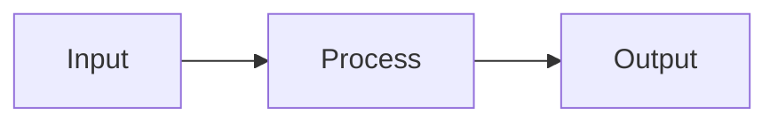

# Report title

One-line context: what was analysed, when, scope.

> **Headline:** the one thing to know, in a sentence.

## Findings

Lead with the conclusion, then the evidence.

- Finding one
- Finding two, with `inline code`

## Data

| Item  | Status   | Count |
|-------|----------|------:|
| Alpha | ok       |    42 |
| Beta  | degraded |     7 |
| Gamma | ok       |   130 |

## Diagram

## Next steps

1. First action
2. Second action
